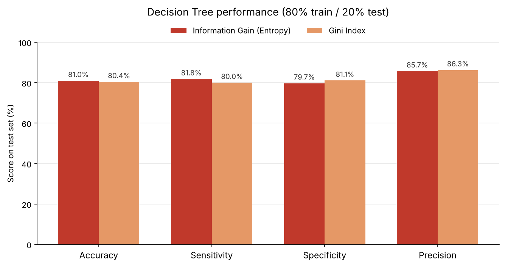

<h1 align="center">🫀 Heart Failure Prediction</h1>

<b>Predicting heart disease risk from clinical indicators with classification and clustering</b>

  

---

## 📁 Project Overview

Heart disease is the leading cause of death worldwide, and it is often diagnosed late. This project uses routine health indicators such as age, blood pressure, cholesterol, and heart rate to identify patients at risk of heart disease, and looks for hidden patient groups that could point to shared risk factors.

---

## 🎯 Objectives

1. Build a classification model that predicts whether a patient has heart disease.
2. Find natural patient groups in the data with clustering.

---

## 🧪 Dataset

- **Source:** [Heart Failure Prediction dataset](https://www.kaggle.com/datasets/fedesoriano/heart-failure-prediction) on Kaggle
- **Size:** 918 patients, 11 clinical features, 1 target (`HeartDisease`)
- **Class balance:** 508 with heart disease, 410 without
- **Key features:** `Age`, `Sex`, `ChestPainType`, `RestingBP`, `Cholesterol`, `FastingBS`, `MaxHR`, `ExerciseAngina`, `Oldpeak`, `ST_Slope`

---

## 📌 Tools Used

- Python (Pandas, NumPy, Matplotlib, Seaborn)
- Scikit-learn and SciPy
- Yellowbrick and Kneed (cluster evaluation)
- Google Colab / Jupyter Notebook

---

## 🔬 Workflow

1. **Exploratory analysis:** summary statistics and charts comparing patients with and without heart disease.
2. **Preprocessing:** replaced 173 invalid zero values in cholesterol and blood pressure with the mean, capped outliers with the IQR method, then applied encoding, normalization, and discretization.
3. **Feature selection:** Chi-square test and correlation analysis; `RestingECG` was dropped.
4. **Classification:** Decision Trees with Information Gain and Gini Index, tested on 70/30, 60/40, and 80/20 splits.
5. **Clustering:** K-Means with K = 2, 3, and 4, evaluated with the silhouette score, WSS, and the elbow method.

---

## 📈 Key Findings

### 1. Risk Indicators
📌 *Insight:* Patients with heart disease tend to be older (median age 57 vs. 51), reach a lower maximum heart rate (median 126 vs. 150 bpm), and more often have exercise-induced angina (62% vs. 13%) and high fasting blood sugar (34% vs. 11%). `ST_Slope` has the strongest correlation with heart disease (−0.56).

### 2. Classification
📌 *Insight:* The 80/20 split performed best for both criteria. **Information Gain** reached the highest accuracy (**81.0%**) and sensitivity (81.8%), while the **Gini Index** had higher specificity (81.1%) and precision (86.3%).

### 3. Clustering
📌 *Insight:* K = 2 gave the best silhouette score (0.20), but the low score shows that patient groups overlap. With labeled data available, classification gives more reliable risk predictions than clustering.

---

## 🧠 Conclusion

Simple clinical measurements carry a strong signal for heart disease. A decision tree identifies about 4 in 5 patients correctly while staying easy to interpret, which matters in a medical setting where doctors need to understand why a patient was flagged.

---

## 👩‍💻 Team

- Ghada Alqahtani
- Renad Alowais
- Deema Alfarhoud
- Norah Alshamsan
- Abeer Alsahli

Data Mining course project, King Saud University.
